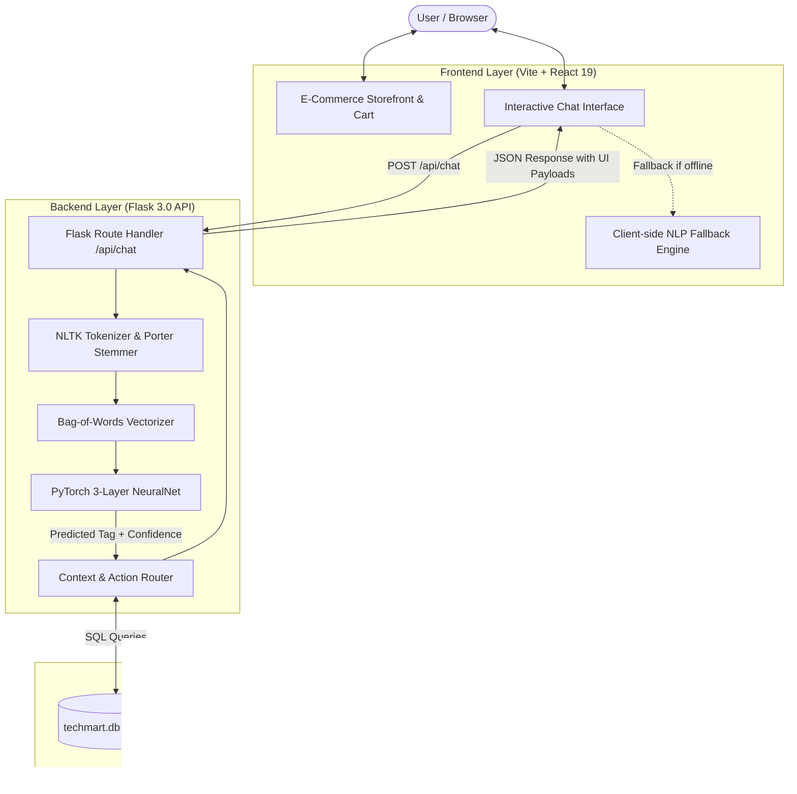

# TechMart AI — Smart Computer Hardware E-Commerce & PyTorch NLP Chatbot

<div align="center">


[](https://vitejs.dev/)
[](https://react.dev/)
[](https://www.python.org/)
[](https://pytorch.org/)
[](https://flask.palletsprojects.com/)
[](https://www.sqlite.org/)
[](LICENSE)

**An intelligent e-commerce ecosystem integrating a deep-learning NLP assistant, real-time hardware compatibility validator, dynamic product comparison, and an end-to-end shopping workflow.**

[Features](#-key-features) • [Architecture](#-system-architecture) • [NLP Engine](#-how-the-nlp-chatbot-works) • [Folder Structure](#-project-folder-structure) • [Installation](#-getting-started) • [API Docs](#-rest-api-reference) • [About the Developer](#-developer--academic-profile)

</div>

---

## 📌 Project Overview

**TechMart AI** is a full-stack, domain-specific e-commerce platform tailored for computer hardware enthusiasts, PC builders, and students. Unlike typical e-commerce storefronts that rely solely on basic keyword search, TechMart integrates a **custom PyTorch-trained neural network chatbot** and a **hybrid client-server NLP router** capable of answering complex inquiries, verifying CPU-motherboard hardware compatibility, performing side-by-side spec comparisons, tracking orders in real-time, and raising support tickets.

Built as a capstone diploma engineering project, it demonstrates the seamless bridge between **Modern Web Engineering (React, Vite, CSS Grid)** and **Machine Learning & Applied NLP (PyTorch, NLTK, Bag-of-Words, Feedforward Neural Networks)**.

---

## ✨ Key Features

### 🤖 Intelligent PyTorch NLP Chatbot
- **19 Custom Intent Classes**: Covers product discovery, spec recommendations, side-by-side comparison, socket compatibility, order tracking, returns, support ticketing, warranty checks, and store policies.
- **Fuzzy Token Matching & Typos**: Intelligently handles common misspellings (e.g., `nvida`, `samsng`, `helo`, `lappy`, `ryzn`).
- **Domain Synonym Dictionary**: 150+ hardware and action synonyms mapping natural conversational slang to structured queries.
- **Side-by-Side Product Comparison**: Generates tabular comparisons highlighting clock speeds, TDP, VRAM, price, and overall rating.
- **Hardware Compatibility Engine**: Validates CPU sockets and motherboard chipsets (e.g., AMD AM4/AM5 vs Ryzen 5000/7000; Intel LGA1700 vs 12th/13th Gen).
- **Interactive Action Cards**: Product recommendations appear as rich interactive cards with direct "Add to Cart" and "View Details" actions.
- **Live Order Tracking**: Visual 4-step progress tracker (`Ordered` → `Shipped` → `Out for Delivery` → `Delivered`) via order IDs.
- **Automated Support Ticketing**: Built-in ticket generator generating unique tracking tokens (e.g., `TKT48291`).

### 🛒 Complete E-Commerce Storefront
- **60+ Hardware SKUs across 13 Categories**: CPUs, GPUs, Motherboards, RAM, SSDs, Monitors, Keyboards, Mice, Laptops, Audio, Studio Lights, Webcams, Networking, and UPS.
- **Dynamic Search & Filtering**: Multi-attribute filtering by category, brand, and maximum budget with instant visual updates.
- **Interactive Cart & Wishlist**: Persistent cart drawer with live subtotal calculation, coupon code application (`TECHMART10`), and tax estimation.
- **Checkout Modal**: Complete shipping detail collection, order summary, and order confirmation simulation.
- **Dark Tech Aesthetic**: Built with a sleek gaming aesthetic, responsive CSS Grid layouts, and smooth micro-interactions (optimized from 360px mobile to 4K displays).

---

## 🏗️ System Architecture

TechMart AI uses a **hybrid decoupled architecture** ensuring high availability: the client can communicate directly with the Flask PyTorch REST backend, while also providing graceful fallback capabilities for standalone client-side deployments (such as Netlify/Vercel static previews).



---

## 🧠 How the NLP Chatbot Works

### 1. Preprocessing Pipeline (`backend/nltk_utils.py`)
1. **Tokenization**: Input sentence is broken down into constituent word tokens via NLTK `word_tokenize`.
2. **Stemming**: Porter Stemmer reduces inflected words to their root base (e.g., `["running", "runs"]` $\rightarrow$ `"run"`).
3. **Bag-of-Words Vectorization**: Matches root tokens against a fixed vocabulary list `all_words`, returning an array of binary flags (`1.0` if word present, `0.0` otherwise).

### 2. PyTorch Neural Network Architecture (`backend/model.py`)
```
Input Layer (Length of Vocabulary: ~150 features)
       │
   Linear(Input_Size, Hidden_Size: 8)  +  ReLU  +  Dropout(0.5)
       │
   Linear(Hidden_Size: 8, Hidden_Size: 8)  +  ReLU  +  Dropout(0.5)
       │
   Linear(Hidden_Size: 8, Output_Classes: 19 Tags)
       │
   Softmax Confidence Evaluation (Threshold: > 0.60)
```

- **Loss Function**: `nn.CrossEntropyLoss`
- **Optimizer**: `torch.optim.Adam` (Learning Rate: `0.001`)
- **Epochs**: `1000` (Trained on `backend/intents.json`)

### 3. Entity Extraction & Action Routing (`backend/app.py`)
Once an intent tag is identified:
- **Price Filters**: Extracted via Regex patterns (e.g., `under 60k`, `₹30000`).
- **Category & Brand Mapping**: Extracted from entity dictionaries.
- **Action Router**: Executes dynamic SQL queries against `techmart.db` to retrieve real-time inventory and order information.

---

## 📁 Project Folder Structure

The repository has been restructured into clean, industry-standard frontend and backend separations:

```
Techmart-smartbot/
├── backend/                         # Flask REST API & PyTorch Machine Learning Engine
│   ├── app.py                       # Main Flask web server & API route endpoints
│   ├── model.py                     # PyTorch 3-layer feed-forward NeuralNet definition
│   ├── nltk_utils.py                # Tokenizer, Porter stemmer & Bag-of-Words builder
│   ├── train.py                     # Model training loop & weights exporter
│   ├── seed_db.py                   # SQLite database initialization & seeder script
│   ├── intents.json                 # Labeled training dataset (patterns & tags)
│   ├── requirements.txt             # Python dependencies (Flask, PyTorch, NLTK, NumPy)
│   ├── data.pth                     # Serialized PyTorch model weights & vocabulary
│   └── techmart.db                  # SQLite database (products, orders, tickets)
│
├── src/                             # Modern Frontend Application (Vite + React)
│   ├── App.tsx                      # Main React application component
│   ├── main.tsx                     # React DOM entry point
│   ├── main.d.ts                    # TypeScript declaration file for script imports
│   ├── index.css                    # Base CSS variables & resets
│   ├── styles/
│   │   └── main.css                 # Comprehensive styling (Tech dark theme & responsive UI)
│   └── scripts/
│       ├── main.js                  # Storefront controller (cart, filters, search, modal UI)
│       ├── database.js              # Hardware catalogue data, specs & initial state
│       └── chatbot.js               # Client-side chatbot engine & API bridge
│
├── index.html                       # Single-page HTML shell
├── package.json                     # Node.js project manifest & scripts
├── package-lock.json                # Locked Node.js dependency tree
├── tsconfig.json                    # TypeScript compiler configuration
├── vite.config.ts                   # Vite bundler & singlefile build configuration
├── .gitignore                       # Ignored build artifacts and environment files
├── LICENSE                          # MIT Open Source License
└── README.md                        # Project documentation
```

---

## ⚡ Getting Started

### Prerequisites
- **Node.js**: v18.0.0 or higher
- **Python**: v3.9 or higher
- **Git**

---

### Step 1: Clone the Repository
```bash
git clone https://github.com/Jadav-Divyaraj/Techmart-smartbot.git
cd Techmart-smartbot
```

---

### Step 2: Setup and Run the Python Backend
Open a terminal and navigate to the `backend/` directory:

```bash
cd backend

# Create a virtual environment (recommended)
python -m venv venv

# Activate virtual environment
# Windows:
venv\Scripts\activate
# macOS/Linux:
source venv/bin/activate

# Install Python dependencies
pip install -r requirements.txt

# Seed the SQLite database with products and orders
python seed_db.py

# (Optional) Retrain the PyTorch model
python train.py

# Launch the Flask API server (runs on http://localhost:5000)
python app.py
```

---

### Step 3: Setup and Run the Frontend
Open a second terminal at the project root (`Techmart-smartbot/`):

```bash
# Install frontend npm dependencies
npm install

# Start the Vite development server
npm run dev
```

Open your browser and navigate to **`http://localhost:5173`** (or the port indicated in your terminal).

---

### Step 4: Building for Production
To bundle the frontend for static hosting (e.g., Netlify, Vercel, GitHub Pages):

```bash
npm run build
```
This generates an optimized production bundle inside the `dist/` directory.

---

## 📡 REST API Reference

The Flask backend exposes the following RESTful API endpoints:

| Method | Endpoint | Description | Request Payload / Params |
|--------|----------|-------------|--------------------------|
| `POST` | `/api/chat` | Main Chatbot interaction endpoint | `{"message": "Show gaming laptops under 70k"}` |
| `GET` | `/api/products` | Retrieve products with optional filters | Query params: `?category=gpu&max_price=50000&brand=NVIDIA` |
| `GET` | `/api/orders/<order_id>` | Fetch order details and live status | URL param: `order_id` (e.g. `/api/orders/TM10045`) |
| `POST` | `/api/tickets` | Submit customer support ticket | `{"name": "...", "order_id": "...", "issue_type": "...", "description": "..."}` |
| `POST` | `/api/compatibility` | Validate CPU and Motherboard socket fit | `{"cpu": "ryzen 7000", "board": "am5"}` |

---

## 💬 Chatbot Query Guide

Try out these queries inside the chatbot:

| Capability | Example User Query | Expected Assistant Action |
|------------|--------------------|---------------------------|
| **Product Search** | *"Show me gaming laptops under 60000"* | Renders filtered product cards with direct "Add to Cart" |
| **GPU Comparison** | *"Compare RTX 4060 vs RTX 5060 Ti"* | Outputs a side-by-side spec comparison table & recommendation |
| **Compatibility** | *"Is Ryzen 7 compatible with B650?"* | Analyzes AM5 socket compatibility and provides advice |
| **Order Tracking** | *"Track order TM10045"* | Displays live visual status bar (`Delivered` / `In Transit`) |
| **Support Ticket** | *"My graphics card is damaged"* | Launches an interactive support ticket submission form |
| **Stock Inquiry** | *"Is WD Black SN770 in stock?"* | Queries database inventory and reports availability |
| **Offers & Deals** | *"Any discounts or coupons?"* | Displays active coupon codes (`TECHMART10`) and sale items |

---

## 📊 Database Schema

```
┌──────────────────────────────────────┐       ┌──────────────────────────────────────┐
│               products               │       │                orders                │
├──────────────────────────────────────┤       ├──────────────────────────────────────┤
│ id           INTEGER [PK, AutoInc]   │       │ id           INTEGER [PK, AutoInc]   │
│ name         TEXT NOT NULL           │       │ order_id     TEXT UNIQUE NOT NULL    │
│ category     TEXT NOT NULL           │       │ customer_name TEXT                   │
│ brand        TEXT NOT NULL           │       │ product_name TEXT                    │
│ price        INTEGER NOT NULL        │       │ status       TEXT DEFAULT 'Proc.'    │
│ old_price    INTEGER                 │       │ tracking_no  TEXT                    │
│ specifications TEXT (JSON string)   │       │ order_date   TEXT                    │
│ stock        TEXT DEFAULT 'In Stock' │       │ amount       INTEGER                 │
│ rating       REAL DEFAULT 4.5        │       └──────────────────────────────────────┘
│ reviews      INTEGER DEFAULT 0       │       ┌──────────────────────────────────────┐
│ badge        TEXT                    │       │               tickets                │
│ emoji        TEXT                    │       ├──────────────────────────────────────┤
└──────────────────────────────────────┘       │ id           INTEGER [PK, AutoInc]   │
                                               │ ticket_id    TEXT UNIQUE NOT NULL    │
                                               │ user_name    TEXT                    │
                                               │ order_id     TEXT                    │
                                               │ issue_type   TEXT                    │
                                               │ description  TEXT                    │
                                               │ status       TEXT DEFAULT 'Open'     │
                                               │ created_at   TEXT                    │
                                               └──────────────────────────────────────┘
```

---

## 🎓 Developer & Academic Profile

- **Developer**: **Divyarajsinh Jadav**
- **Institution**: **R.C. Technical Institute (RCTI), Ahmedabad**
- **Program**: Diploma in Computer Engineering
- **GitHub**: [@Jadav-Divyaraj](https://github.com/Jadav-Divyaraj)
- **Project Role**: Full Stack Developer & NLP Engineer (Ideation, PyTorch Model Training, UI/UX Design, Database Schema, API Integration)

---

## 📜 License

This project is licensed under the [MIT License](LICENSE) — you are free to use, modify, and distribute this codebase for academic and open-source purposes.
